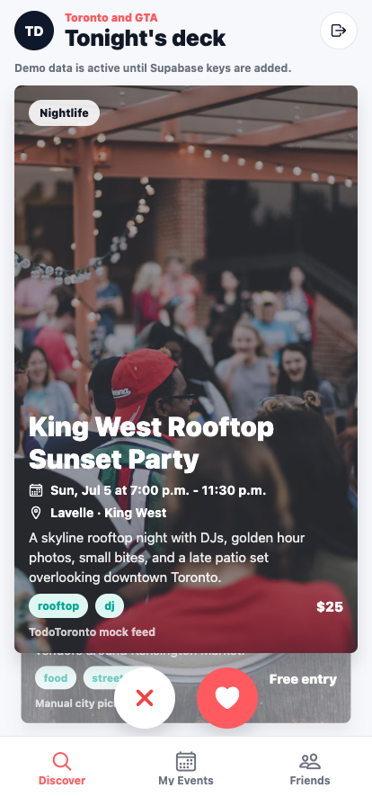
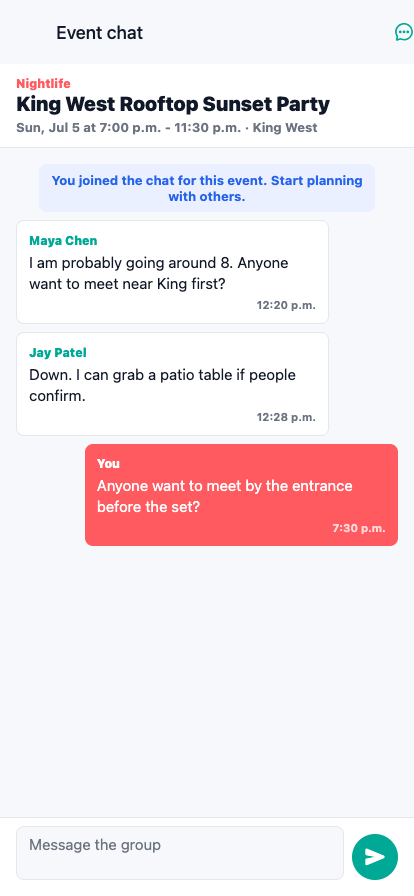
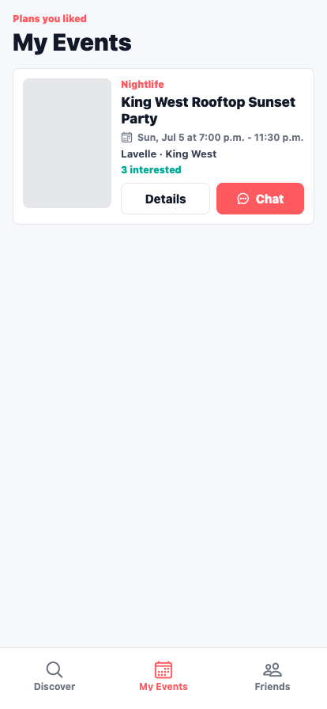
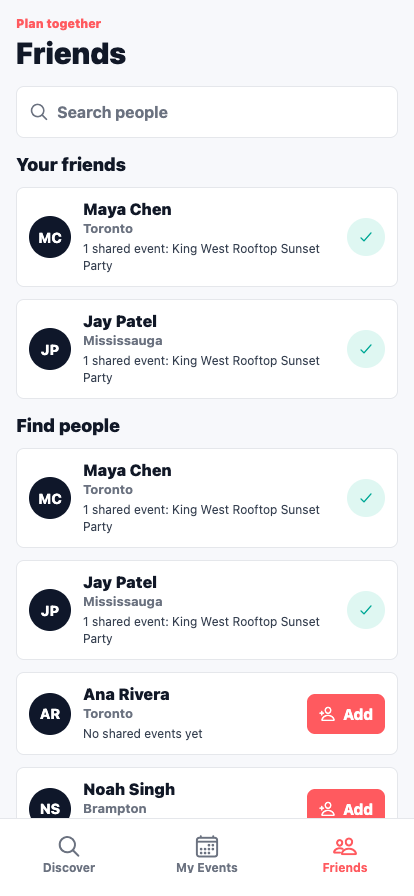

# EventSwipe GTA

EventSwipe GTA is a mobile-first demo for finding something to do in Toronto and the Greater Toronto Area. Swipe right on an event to save it and join the group chat for that plan.

One Expo and TypeScript app runs on iOS, Android, and the web. The public demo uses sample events and people; the project also includes a Supabase backend for authenticated use.

## Live Demo

**[Try EventSwipe GTA on Vercel](https://eventswipe-gta.vercel.app/)** on your phone or desktop. No account, install, or credentials required.

Choose **Continue as Demo User**, tap the heart on an event, then tap **Chat** in the “Joined chat” banner. Send a message and open **My Events** to find the same conversation again. Each visitor gets their own copy of the demo: messages are not shared across browsers, and refreshing resets the session.

## Screenshots

<p align="center">
  
  
  
  
</p>

## What It Demonstrates

- A single action connects discovery to planning: liking an event records interest and adds the user to its chat.
- The screens use the same event service whether the data is held locally or stored in Supabase.
- Social context follows the event: see who is interested, find friends with shared plans, and return to a conversation from the saved list.

## Features

- Browse 12 sample Toronto and GTA events with photos, dates, neighbourhoods, prices, categories, and sources.
- Swipe or use the skip and heart buttons. Tap a card for its address, full description, and interested people.
- Send timestamped messages in event-specific chats.
- Search sample profiles, add friends, and see the events you have in common.
- Reopen details and chats from **My Events** without going back through the deck.

## Stack

Expo SDK 53, React Native, React Native Web, TypeScript, React Navigation, Supabase Auth, PostgreSQL, Supabase Realtime, and Vercel.

## Technical Highlights

- [SwipeDeck](./src/components/SwipeDeck.tsx) uses PanResponder and Animated for drag, rotation, release, and button-driven swipes.
- [EventProvider](./src/services/eventProvider.ts) handles event reads, interests, chat membership, messages, and friends. The mock provider notifies local chat listeners; the Supabase provider subscribes to message inserts.
- The [database schema](./supabase/schema.sql) includes row-level policies for authenticated access and unique user/event pairs for interests and memberships.

## Current Scope

All listings, dates, attendance, and conversations are illustrative, not live event recommendations. Source labels are examples, not claims of partnership. No Instagram content is scraped. The map is a placeholder and adding a friend is immediate in the demo.

## Local Setup

Install Node.js 22 and npm, then run this from the repository root:

```bash
npm ci
```

## Supabase Setup (Optional)

Skip this section for the same experience as the public demo. For database-backed use, create a Supabase project, enable email/password auth, and run [schema.sql](./supabase/schema.sql) followed by [seed.sql](./supabase/seed.sql) in the SQL editor.

## Environment Variables

No environment variables are required for mock mode. For Supabase mode, copy [.env.example](./.env.example) to `.env` and set `EXPO_PUBLIC_SUPABASE_URL` and `EXPO_PUBLIC_SUPABASE_ANON_KEY`. Use only the public client key, never a service-role key. Restart Expo (or rebuild the web export) and use **Login with email** with a confirmed account.

## Run The App

```bash
npm run web
```

Open the local URL printed by Expo. To build for Vercel, run `npm run build:web`. The checked-in [Vercel config](./vercel.json) serves the static export from `dist/`.

## Use It On Your Phone

The [live demo](https://eventswipe-gta.vercel.app/) opens directly in Safari or Chrome. For native development, run `npm start` and open the QR code with an Expo Go client compatible with SDK 53, or use a simulator.

## Project Notes

The [sample events](./src/data/mockEvents.ts) and [social seed data](./src/data/mockUsers.ts) can be edited independently of the screens. [Provider placeholders](./src/services/apiProviders.ts) identify where Ticketmaster Discovery, Toronto Open Data, Eventbrite, or a manually approved TodoToronto feed could be integrated later. Fetch and normalize future feeds on a trusted backend; keep provider secrets out of the app bundle.

## Scripts

```bash
npm start             # Expo development server
npm run web           # Web development
npm run ios           # iOS
npm run android       # Android
npm run typecheck     # TypeScript checks
npm run build:web     # Production web export
```
